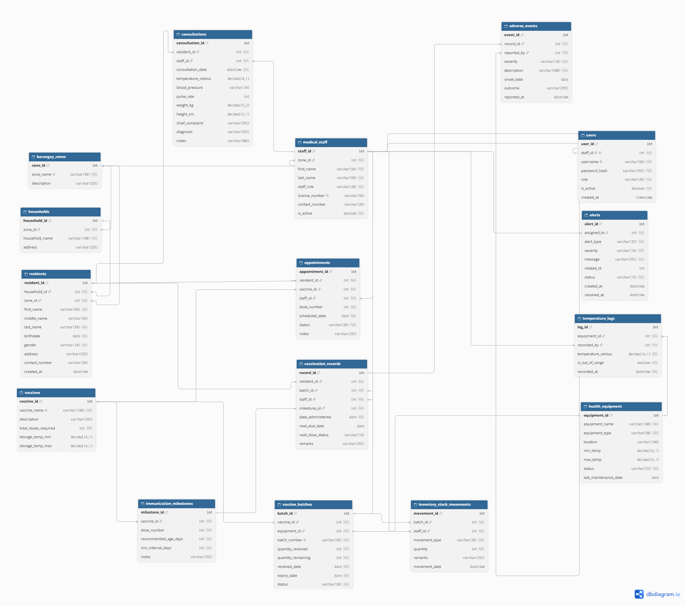

# Barangay Healthcare & Vaccination Management System
A barangay health center system for tracking resident vaccinations and vaccine stock (DBMS and SIA)

## Group Members
- Almarez, Gian
- Abad, Christ John
- Alde, Ian Laurence
- Aba, Joseph
- Arayan, Michael Vince
- Acodesin, Angelique

## Ownership Matrix
| Member | GitHub username | Tables | Endpoints / screens | Join report(s) and join type | Feature role |
|---|---|---|---|---|---|
| Almarez, Gian | itssgiann | Users, Medical_Staff, Barangay_Zones | /api/users, /api/staff, /api/zones, /api/staff/with-zones | Staff + Zones, INNER JOIN | Core |
| Abad, Christ John | KingHunter752189 | Residents, Vaccines | /api/residents, /api/vaccines, /api/residents/with-records, /api/residents/report, /api/expiry/expiring | Residents + Vaccination Records, LEFT JOIN (PR #69) | Master data + Unique feature (batch expiry check) |
| Alde, Ian Laurence | ianalde9-oss | Vaccination_Records, Appointments, Consultations | /api/vaccination-records, /api/appointments, /api/consultations, /api/appointments/with-records | Appointments + Vaccination Records, FULL OUTER JOIN (LEFT JOIN + RIGHT JOIN with UNION) | Transactions |
| Aba, Joseph | abajoseph | Vaccine_Batches, Immunization_Milestones, Inventory_Stock_Movements | /api/batches, /api/milestones, /api/stock-movements, /api/batches/with-vaccines, /api/stock-movements/batch/:batchId | Vaccine Batches + Vaccines, RIGHT JOIN | Unique feature (rules) |
| Arayan, Michael Vince | Mivennz | Health_Equipment, Temperature_Logs, Alerts | /api/equipment, /api/temperature-logs, /api/alerts, /api/equipment/with-logs | Health Equipment + Temperature Logs, LEFT JOIN | Unique feature (workflow, alerts) + Audit |
| Acodesin, Angelique | Jigzx | Households, Adverse_Events | /api/households, /api/adverse-events, /api/adverse-events/with-residents | Adverse Events + Vaccination Records + Residents, INNER JOIN | Reports |
--- 

## ER Diagram

[Open the image file](docs/erdiagram.png) · [View on dbdiagram.io](https://dbdiagram.io/d/6ae8a39f027db74914c6d467)

## How to Run

Must have these to start:
- [Node.js](https://nodejs.org) (LTS version) and npm
- [XAMPP](https://www.apachefriends.org) (MySQL and phpMyAdmin)
- Git
- Postman (optional, for testing the API)

### 1. Get the code
git clone <https://github.com/itssgiann/barangay-health-vaccination-system>  
cd barangay-health-vaccination-system

### 2. Start MySQL
1. Open the **XAMPP Control Panel**.
2. Click **Start** next to **Apache** and **MySQL**. Both must turn green.

### 3. Set up the database
1. Open http://localhost/phpmyadmin in your browser.
2. Click the **Import** tab, choose `schema.sql`, scroll down, and click **Import**. This creates the `barangay_vaccination_system` database and all of its tables.
3. Click the **Import** tab again, choose `seed.sql`, and click **Import**. This adds the sample data.

Import `schema.sql` first and `seed.sql` second. The seed needs the tables from the schema. If you imported an older version before, delete the old database in phpMyAdmin first and import both files again.

### 4. Set up the environment file
The `.env.example` file is in the main folder of the project. Copy it into the `backend` folder and name the copy `.env`.  
Run this from the main folder:  
copy .env.example backend\.env

The default values work with a fresh XAMPP install:
PORT=5000
DB_HOST=localhost
DB_USER=root
DB_PASSWORD=
DB_NAME=barangay_vaccination_system
JWT_SECRET=change_this_to_any_long_random_text  
If your MySQL root user has a password, put it in `DB_PASSWORD`. Never commit your `.env` file.

### 5. Install the packages
Open a terminal in the `backend` folder and run:

cd backend
npm install
### 6. Start the server
npm start

You should see `Server running on port 5000`. The server restarts by itself when you save a file. If you change `.env`, type `rs` in the terminal and press Enter.

### 7. Open the system
- **Frontend:** http://localhost:5000
- **API base URL:** http://localhost:5000/api

To check that everything works, open http://localhost:5000/api/staff/with-zones in your browser or Postman. You should see the staff list with their zone names. See the ownership matrix above for all the endpoints.

___
### Troubleshooting
| Problem | What to do |
|---|---|
| MySQL won't start, "port 3306 in use" | Another MySQL is running on your computer. Stop it in Windows Services, or change XAMPP's MySQL port. |
| `Access denied for user 'root'@'localhost'` | `DB_PASSWORD` in `.env` doesn't match your MySQL root password. Fix it, then type `rs` in the server terminal. |
| `Unknown database` | `schema.sql` hasn't been imported yet. |
| Foreign key error while importing | Import `schema.sql` before `seed.sql`. If it still fails, delete the old database and import both again. |
| `Cannot find module` or npm errors | Run `npm install` inside the `backend` folder, where `package.json` is. |
| The page doesn't open at localhost:5000 | Start the server from inside the `backend` folder. |
| An API URL returns 404 | Check the spelling against the endpoint list in the ownership matrix. |

## Unique Feature: Batch Expiry Check and Alerts

Vaccines that are past their expiry date must never be given to residents, and nearly expired stock should be used or replaced first. The expiry check does this automatically instead of relying on staff to read dates. When a staff member runs POST /api/expiry/check, the system (1) marks every batch whose expiry_date is before today as Expired, (2) creates a Near_Expiry alert for every batch that will expire within the warning window (default 30 days, adjustable with days) and still has stock, and (3) creates a Severe alert for expired batches that still have stock left. The alert severity depends on how close the expiry is: 7 days or less is Severe, otherwise Moderate. GET /api/expiry/expiring?days=N lists the batches that are about to expire, with the number of days left.

Edge case to demo: run the check twice in a row. The second run creates no new alerts, because a batch that already has an open Near_Expiry alert is skipped (the query uses a LEFT JOIN to alerts and keeps only batches with no match). Other cases the check handles: batches with 0 stock remaining get no alert, batches already marked Expired are not listed as expiring, an invalid days value returns 400, and a staff_id that does not exist returns 400.

